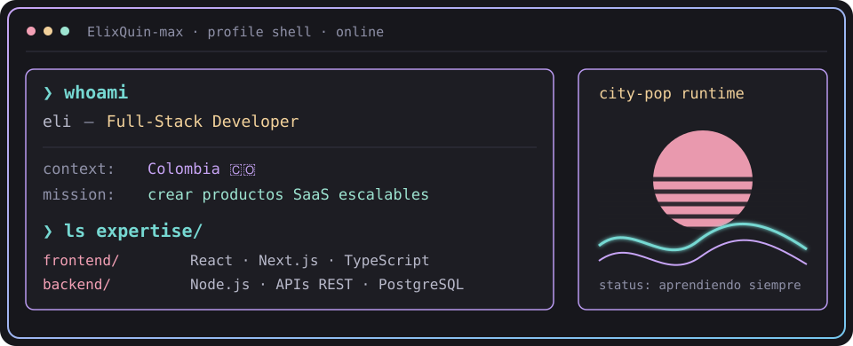

<!-- BANNER ANIMADO (generado por scripts/generate.py) -->
<a href="https://github.com/ElixQuin-max">
  <picture>
    <source media="(prefers-color-scheme: dark)" srcset="assets/banner-dark.svg">
    <source media="(prefers-color-scheme: light)" srcset="assets/banner-light.svg">
    
  </picture>
</a>

 

---

## `$ whoami`

  

 

## `$ cat tech-stack.yaml`

<table border="1" cellpadding="14" bgcolor="#17171c">
  <thead>
    <tr>
      <th colspan="2" align="left"><code>ElixQuin-max:~$ cat tech-stack.yaml</code></th>
    </tr>
  </thead>
  <tbody>
    <tr>
      <td width="50%" valign="top"><code>├─ ✦ frontend:</code>  
         
        <code>HTML · CSS · JavaScript · TypeScript · React · Next.js · Tailwind</code>
      </td>
      <td width="50%" valign="top"><code>├─ ⚙ backend:</code>  
         
        <code>Node.js · Express · Python · FastAPI</code>
      </td>
    </tr>
    <tr>
      <td width="50%" valign="top"><code>├─ ▣ databases:</code>  
         
        <code>PostgreSQL · MySQL · MongoDB · Prisma · Supabase</code>
      </td>
      <td width="50%" valign="top"><code>╰─ ☁ devops_tools:</code>  
         
        <code>Docker · Git · GitHub · GitHub Actions · Vercel · VS Code</code>
      </td>
    </tr>
  </tbody>
  <tfoot>
    <tr>
      <td colspan="2"><code>status: building&nbsp;&nbsp;·&nbsp;&nbsp;environment: production</code></td>
    </tr>
  </tfoot>
</table>

---

## `$ npm run stats --all`

  <picture>
    <source media="(prefers-color-scheme: dark)" srcset="assets/radar-dark.svg">
    <source media="(prefers-color-scheme: light)" srcset="assets/radar-light.svg">
    
  </picture>&nbsp;
  <picture>
    <source media="(prefers-color-scheme: dark)" srcset="assets/radar-langs-dark.svg">
    <source media="(prefers-color-scheme: light)" srcset="assets/radar-langs-light.svg">
    
  </picture>

<code>signals: skill_radar · language_stack_radar · status: healthy</code>

---

## `$ connect --socials`

&nbsp;&nbsp;
&nbsp;&nbsp;

 
 

Hecho con 💖 y mucho café desde Colombia · @ElixQuin-max

